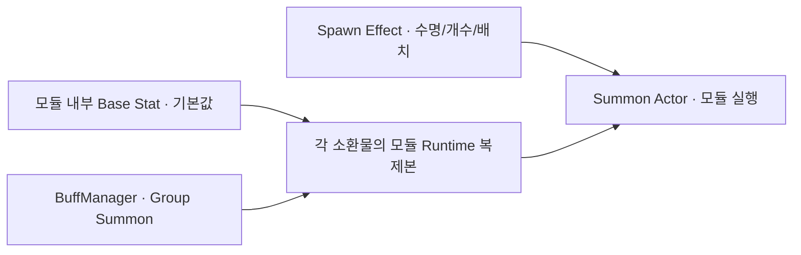

# 소환물의 모듈별 스탯 설정

소환 효과는 소환물을 생성합니다. 생성된 소환물은 Modules에 연결된 기능을 실행합니다. **기본 기능 스탯은 각 모듈 내부의 Base Stat에서 설정하고, 버프는 소환물마다 복제한 런타임 스탯에만 적용합니다.** Actor에는 공통 기본 공격 스탯이 없습니다.

| 인스펙터 | 설정하거나 확인하는 값 |
| --- | --- |
| Summon Spawn Effect → Spawn Stat | 생성 수명·개수·배치. 실행할 때 복제·버프 계산 |
| Summon Actor → Modules | 소환물이 사용할 기능 모듈 목록 |
| 각 모듈 → 기본 스탯 (Base Stat) | 해당 기능의 기본값. 별도 스탯 에셋 없이 모듈 안에서 편집 |
| 실행 중 Summon Actor → 모듈별 현재 스탯 | 모듈별 버프·실행 범위 배율이 반영된 값. 읽기 전용 |
| Summon Definition | 종류 식별·태그·소속 Summon Group. 체력 등 수치 없음 |
| Summon Group Definition | 무리의 종류/개체 수 조건과 조건 달성 시 사용할 아이템 |

## 모듈 안에서 기본 스탯 설정하기

1. **Create → 04.Items → Effects → Direct Effects → Summon → Summon Modules**에서 기능 모듈을 만듭니다.
2. 모듈 인스펙터의 **기본 스탯**에서 피해량·주기·범위 등을 직접 입력합니다. `StatDefinition`을 만들거나 연결하지 않습니다.
3. 소환물 프리팹의 **Summon Actor → Modules**에 모듈을 연결합니다. 이동을 먼저 실행하려면 이동 모듈을 공격 모듈보다 앞에 둡니다.
4. Summon Spawn Effect의 **Summon Prefab**에 프리팹을 연결하고 생성 수명·개수·배치를 설정합니다.

같은 모듈 에셋을 여러 소환물이 공유할 수 있습니다. 실행 시 각 소환물의 모듈 Runtime이 기본값을 복제하므로 타이머·발동 횟수·버프 결과는 독립적입니다. 이미 실행 중인 생명의 기본값은 모듈 에셋을 편집해도 바뀌지 않으며, 이후 생성한 소환물에는 새 기본값을 사용합니다. 버프 변경은 기존 소환물의 런타임 값에 반영됩니다.

| 드롭다운 구분 | 모듈 / 스탯 타입 | 사용하는 수치 |
| --- | --- | --- |
| 생성 | SummonSpawnStat | lifetime, count, spreadRadius, spreadAngle, forwardSpacing, sideSpacing |
| 공격 | Contact Damage / SummonContactDamageStat | damage, radius, interval |
| 공격 | Contact Effects / SummonContactEffectStat | radius, repeatInterval, activationCount |
| 공격 | Turret / SummonTurretStat | damage, range, interval, projectileSpeed, projectileLifetime, projectileRadius |
| 공격 | Item Throw / SummonItemThrowStat | damage, damageMultiplier, healingMultiplier, range, interval, shotCount, 배치 수치 |
| 이동 | Orbit / SummonOrbitStat | radius, angularSpeed, initialAngle |
| 이동 | Pull / SummonPullStat | range, speed, tickInterval, stopDistance |
| 지원 | Aura / SummonAuraStat | range, scanInterval, maximumTargets |
| 지원 | Periodic Spawn / SummonPeriodicSpawnStat | interval, activationCount |
| 지원 | Health / SummonHealthStat | maxHealth, defense |

사용하지 않는 수치는 모듈 인스펙터에서 숨깁니다. 예를 들어 제한을 끄면 activationCount, OnEnter에서는 repeatInterval, Item Throw에서 Use Module Damage를 끄면 damage, 고정점 투척에서는 배치 수치가 보이지 않습니다. 개수는 float로 버프 계산 후 소수점을 버립니다.

## 접촉 피해와 접촉 이펙트

**Contact Damage**는 원형 범위 안의 적에게 damage만큼 직접 피해를 줍니다. 같은 적은 interval마다 다시 피해를 받습니다. Actor 공격력과 모듈 기본 피해를 더하던 중복 계산은 제거했습니다.

모듈의 **First Hit Timing (첫 피해 시점)**에서 **즉시** 또는 **인터벌 후**를 선택합니다. 즉시는 진입하자마자 첫 피해를 주고, 인터벌 후는 적이 범위에 진입한 뒤 interval이 지나야 첫 피해를 줍니다. 이후 두 옵션 모두 interval마다 반복합니다. 기본값은 즉시이므로 기존 에셋의 동작은 유지됩니다. 인터벌 후에서 적이 범위를 벗어났다가 재진입하거나 새 생명으로 재활용되면 대기를 다시 시작합니다. 대기 중에도 주기 버프의 변경이 반영됩니다. 첫 피해를 확인하려면 소환물 수명을 대기 주기보다 길게 설정하세요.

**Contact Effects**는 자동 피해 없이 **Contact Effects** 목록의 Hit Effect를 실행합니다. 기절·속박·적 버프 등을 연결할 수 있고, 일반 아이템 효과는 **Execute Effects (ExecuteEffectOnHitData)**의 Effects에 넣어 연결합니다. 한 번의 발동에서 목록 전체를 실행합니다.

| 옵션 | 동작 |
| --- | --- |
| Trigger Mode = OnEnter | 적이 범위에 들어왔을 때 한 번. 나갔다가 다시 들어오면 새 접촉 |
| Trigger Mode = WhileTouching | 범위에 머무는 동안 repeatInterval마다 실행 |
| Limit Activations 꺼짐 | 횟수 제한 없음 |
| Limit Scope = PerSummon | 이 소환물의 모듈 전체에서 activationCount번 |
| Limit Scope = PerTarget | 적의 생명마다 activationCount번. 범위 이탈 후 재진입해도 누적 횟수 유지 |

실제 이펙트가 하나 이상 성공한 접촉만 횟수에 포함합니다. 조건·확률로 적용되지 않으면 제한 횟수를 소비하지 않습니다. 반복 모드의 재시도 간격은 유지됩니다. 하나의 적에 여러 Collider가 있어도 같은 조회에서 한 번만 처리합니다. 재활용된 적의 새 생명은 별도 대상입니다. 모듈 에셋을 공유해도 소환물별 타이머와 횟수는 독립적입니다.

`ContactEffects_ThreeTimes.asset` 예제는 진입 시 기절을 소환물당 총 3번 실행합니다. 새 모듈은 기존 Food28 프리팹에 자동으로 추가하지 않았으므로 원하는 프리팹의 Modules에 연결해 사용하세요.

## 주기적으로 다른 소환물 생성하기

**Periodic Spawn**의 **Spawn Effects**에 다른 Summon Spawn Effect들을 연결합니다. 모듈의 기본 스탯에서 interval을 설정하고, 각 Spawn Effect에서 어떤 프리팹을 몇 개 생성할지와 자식의 수명을 정합니다.

- **In Order**: 매 주기 다음 효과를 선택하고 마지막 다음에는 처음으로 돌아갑니다.
- **Random**: 매 주기 무작위 효과 하나를 선택합니다.
- **All**: 매 주기 목록의 모든 효과를 실행합니다.

**Limit Activations**를 켜면 activationCount만큼 성공한 주기를 실행합니다. 한 주기에 자식 여러 개를 생성해도 횟수는 1회입니다. 비어 있거나 실행할 수 없는 슬롯은 생략하며, 전체가 실패한 주기는 횟수를 소비하지 않습니다. 긴 프레임에는 최대 한 주기만 실행합니다. 원래 효과 실행의 순환 방지와 취소 규칙도 유지됩니다.

`PeriodicSpawn_Alternating.asset`은 2초마다 Food28 소환물 1개 → 2개 → 1개를 생성하고 끝납니다. 원하는 부모 프리팹의 Modules에 연결하세요. 자식은 자신이 가진 모듈을 실행하며 부모에 붙인 모듈을 상속하지 않습니다. 부모의 자연 종료 후에도 자식은 자신의 수명 동안 유지됩니다. 원래 아이템 실행 전체가 취소되면 자식 실행도 취소됩니다.

## 체력과 버프

피격·회복 대상인 소환물에는 **Health** 모듈을 추가합니다. 최대 체력과 방어력은 Health 모듈의 기본 스탯에 설정하고 방어 계산 방식은 모듈의 Defense Formula로 선택합니다. Actor당 첫 Health 모듈 하나를 사용합니다. 버프 또는 모듈 재구성으로 수치를 갱신해도 기존 HP를 자동으로 채우지 않으며, 새 생명 초기화 때만 채웁니다. Health 모듈을 제거하면 피격 대상 기능도 해제합니다.

BuffEffect의 Target Resolver를 **Group = Summon**, **Direct**, 또는 **All Targets**로 지정하고, Float Field Modifier에서 위 표의 기능 스탯 타입을 고릅니다. 기존 소환물을 즉시 갱신·해제 시 복원하려면 **Apply Timing = Dynamic**을 사용합니다.

| 바꾸려는 값 | 스탯 / 필드 | Modifier 설정 |
| --- | --- | --- |
| 접촉 피해 +50% | SummonContactDamageStat / damage | Multiply = 0.5 |
| 포탑 발사 간격 절반 | SummonTurretStat / interval | Multiply = -0.5 |
| 공전 반경 +1 | SummonOrbitStat / radius | Add = 1 |
| 접촉 발동 제한 +2회 | SummonContactEffectStat / activationCount | Add = 2 |
| 주기적 소환 간격 -0.5초 | SummonPeriodicSpawnStat / interval | Add = -0.5 |
| 최대 체력 +20 | SummonHealthStat / maxHealth | Add = 20 |

All Items는 소환 **생성 효과**의 스탯을 바꾸는 대상으로 사용합니다. 모듈 기능 스탯은 아이템 Snapshot에 고정하지 않고 실제 소환물 대상에서 계산합니다. 인스펙터 조회와 일반 재계산은 횟수제 버프를 소비하지 않습니다. 공격 모듈은 실제 발동할 때 값을 캡처하고 마지막 사용에도 해당 공격에는 버프값을 사용합니다. 다음 발동부터 해제된 런타임 값을 사용합니다. 이동·오라·체력처럼 지속적으로 유지하는 값은 Dynamic/지속시간 버프를 사용하세요.

범위와 지속시간의 실행 배율은 런타임 복제본에 적용합니다. 피해 실행 배율은 실제 피해 계산에서 한 번 적용하므로 인스펙터의 damage와 최종 HP 감소량은 실행 배율·방어 등에 따라 다를 수 있습니다.

## 무리 조건으로 추가 소환하기

각 종류의 **Summon Definition → Summon Group**에 같은 무리를 연결하면 필드의 종류 수·개체 수를 집계합니다. 무리의 **Item Rules**에서 조건과 사용할 아이템을 정하고, 그 아이템에 소환 효과를 연결하면 조건 달성 시 추가 소환할 수 있습니다. 즉시 사용과 투척 모두 지원합니다. 설정과 슬라임 예제는 [소환 무리와 조건 달성 아이템](SummonGroups.md)을 참고하세요.

## 기존 에셋과 검사

최신 `0a800f64`의 프리팹·씬 구성을 그대로 유지하고, 기본 스탯 프로필 5개의 값을 연결된 모듈의 Base Stat에 옮겼습니다. Food28의 접촉 피해는 사용자가 수정한 damage = 5, radius = 0.3, interval = 1과 첫 피해 시점 **인터벌 후**를 유지합니다. 별도 StatDefinition 스크립트·스탯 프로필 에셋은 제거했지만 기능별 스탯 타입과 버프 Modifier의 타입·필드는 유지했습니다.

이름이 바뀐 Food28 생성 효과의 이전 GUID를 가리키던 ItemData·예제 연결은 `SummonSpawnEffect 1.asset`에 갱신했습니다. 소환 프리팹 3개와 공용 프리팹의 값은 변경하지 않았습니다.

Unity **Window → General → Test Runner → EditMode**에서 `SummonModuleTests`, `SummonSpawnTests`, `SummonArchitectureEditorTests`, `AdditionalSummonTests`, `AllTargetsBuffTests`를 실행할 수 있습니다. 접촉 피해의 실제 HP 변화, 접촉 횟수, 다른 개수의 주기적 소환, 모듈 공유·버프 해제·체력 유지 등을 확인합니다.

클라우드에서는 `python3 Tools/ValidateEffects/check.py --cache /workspace/.cache/catnip-validation`으로 C# 컴파일, Inspector 타입 목록, 관리 코드의 접촉·주기·배치 로직을 검사합니다. Unity 에디터가 없는 환경에서는 물리/PlayMode 테스트가 실행되지 않으며, 이 검사는 Unity 자체 테스트 통과를 의미하지 않습니다.
