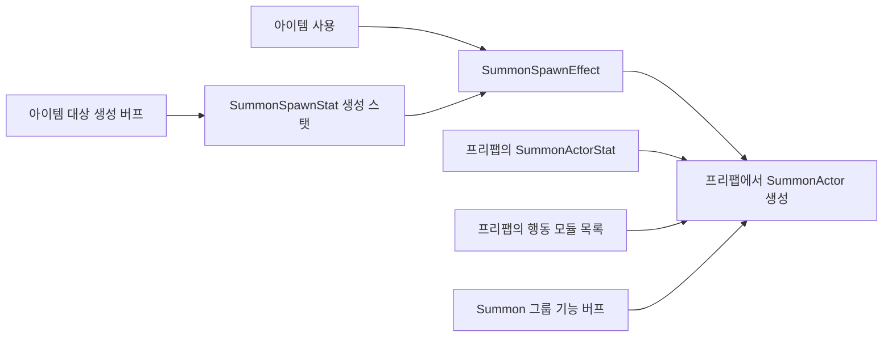

# 소환 생성과 소환물 기능

소환은 생성 설정과 소환물 설정을 따로 관리합니다.

| 위치 | 스탯/설정 | 역할 |
|---|---|---|
| SummonSpawnEffect 에셋 | SummonSpawnStat | 지속시간, 생성 개수, 퍼뜨릴 반경/각도, 앞/옆 배치 간격 |
| SummonSpawnEffect 에셋 | Summon Prefab, Placement Mode | 어떤 소환물을 어떤 모양으로 생성할지 |
| 소환물 프리팹의 SummonActor | Base Actor Stat / SummonActorStat | 공격력, 공격 주기, 탐색 범위, 피해/회복 배율 |
| 소환물 프리팹의 SummonActor | Modules | 투척, 포탑, 접촉 피해, 공전, 끌어당김, 오라 |
| 소환물 프리팹의 SummonActor | Definition | 종류, 태그, 체력 설정 |



## 새 소환 효과 만들기

1. 소환물 프리팹에 **SummonActor**를 붙입니다. **Base Actor Stat**에 공격력·공격 주기·탐색 범위·피해/회복 배율을 입력합니다.
2. 기능 모듈 에셋을 만들어 프리팹의 **Modules**에 연결합니다. 메뉴는 `Create → 04.Items → Effects → Direct Effects → Summon → Summon Modules`입니다.
3. `Create → 04.Items → Effects → Direct Effects → Summon → Spawn`으로 **SummonSpawnEffect**를 만듭니다.
4. **Summon Prefab**에 프리팹을 넣고 **Spawn Stat**을 설정합니다.
5. 아이템의 Effect Datas에 생성 효과를 연결합니다.

생성 효과에는 공격력·투척 아이템·Definition·모듈 교체 옵션이 없습니다. 같은 프리팹을 사용하는 효과는 소환물의 기본 기능을 공유하고 생성 수명·개수·배치만 다르게 설정할 수 있습니다. 기능이 다른 소환물이 필요하면 별도 프리팹 또는 프리팹 Variant를 사용합니다.

## 생성 스탯

| 필드 | 의미 |
|---|---|
| lifetime | 이번에 생성할 소환물의 유지 시간(초) |
| count | 생성 개수. 버프 계산 후 소수점을 버려 0~128개로 결정. 0이면 생성하지 않음 |
| spreadRadius | 원형/부채꼴 배치 반경 |
| spreadAngle | 원형/부채꼴이 차지할 각도 |
| forwardSpacing | Forward 배치의 앞쪽 간격 |
| sideSpacing | Forward 배치의 옆쪽 간격 |

**Placement Mode**는 FixedPoint(같은 위치), Forward(일렬), CircleEven(균등 원형), CircleRandom(범위 내 무작위), Shotgun(반경 위 균등 부채꼴)을 지원합니다. 방향은 아이템 실행 방향이며 방향이 없으면 월드 오른쪽을 사용합니다. Spread Start Mode와 Clockwise Spread로 시작 위치·순서를 설정합니다.

예를 들어 `count = 3`, `spreadRadius = 2`, `spreadAngle = 360`, Placement Mode = CircleEven이면 목표 위치 주변 반경 2에 소환물 3개를 균등 배치합니다. 배치 위치의 z는 0입니다.

생성 시 계산한 개수·배치·수명을 각 인스턴스에 전달합니다. 이후 생성 버프가 바뀌어도 이미 생성한 개수나 위치, 정해진 수명은 바뀌지 않습니다. 기존 소환물의 남은 수명을 즉시 늘리려면 **Summon Modify → Add Remaining Lifetime**을 사용합니다.

## 소환물 기능과 모듈

| SummonActorStat 필드 | 역할 |
|---|---|
| attackPower | 공격 모듈이 참조할 공격력 |
| attackInterval | 투척/포탑의 기본 공격 주기 |
| detectionRange | 적 탐색·끌어당김·오라 등에 사용하는 기본 범위 |
| damageMultiplier | 소환물이 실행하는 피해 배율 |
| healingMultiplier | 소환물이 실행하는 회복 배율 |

모듈은 프리팹의 Modules에 원하는 순서로 여러 개 연결합니다. **Orbit + Contact Damage**를 넣으면 공전하면서 접촉 피해를 주고, **Turret + Aura**를 넣으면 탄환을 쏘면서 다른 소환물을 강화합니다. 이동 모듈을 공격 모듈보다 앞에 두면 이동한 위치에서 공격합니다.

목록이 비어 있으면 기능 없이 유지됩니다. 각 소환물은 같은 모듈 에셋을 사용해도 타이머·대상·이동 상태를 가진 Runtime을 독립적으로 생성합니다.

- **Item Throw**: 던질 Item, 대상 방식, 발사 개수/배치를 모듈에 지정합니다. **Use Actor Attack Power**를 켜면 아이템의 기본 피해 대신 소환물 attackPower를 사용합니다. 끄면 아이템 자체 피해를 사용합니다.
- **Turret / Contact Damage**: 기본 피해는 `모듈 baseDamage + 소환물 attackPower × 모듈 attackPowerMultiplier`입니다. 여기에 피해 배율과 실행 배율을 적용합니다.
- **Contact Damage**는 자체 hitInterval/contactRadius를 사용합니다. 모든 모듈이 attackInterval/detectionRange를 공통으로 사용하는 것은 아닙니다.
- **Definition**을 통해 종류·태그·체력을 설정합니다. 소환물의 Health는 별도의 HealthStat 버프를 받습니다.

플레이 중 **SummonActor → Runtime Stat → Current Actor Stat**에서 기능 버프가 적용된 최종 수치를 확인합니다. Spawn Lifetime은 생성 효과에서 전달받은 현재 인스턴스의 수명입니다. Base Actor Stat은 기본 설정이므로 버프가 적용돼도 원본 값이 바뀌지 않습니다.

## 두 종류의 버프 설정

| 목적 | 대상 리솔버 | Modifier 타입 / 필드 |
|---|---|---|
| 소환 개수 +2 | All Items 또는 소환 아이템을 가리키는 Owner | SummonSpawnStat / count, Add = 2 |
| 생성 수명 +50% | All Items 또는 Owner | SummonSpawnStat / lifetime, Multiply = 0.5 |
| 생성 배치 반경 +1 | All Items 또는 Owner | SummonSpawnStat / spreadRadius, Add = 1 |
| 기존/새 소환물 공격력 +50% | Group = Summon | SummonActorStat / attackPower, Multiply = 0.5 |
| 소환물 공격 간격 절반 | Group = Summon | SummonActorStat / attackInterval, Multiply = -0.5 |

**All Targets**는 두 경로를 함께 포함하며 Modifier의 타입이 적용할 스탯을 구분합니다. 기능 스탯도 소환물 자체의 기본값을 바탕으로 원본 아이템의 Snapshot/Dynamic 버프와 Summon 그룹/Direct 버프를 계산할 수 있습니다. 아이템과 오브젝트 양쪽에서 같은 All Targets 버프를 조회해도 한 번만 적용합니다.

같은 아이템 사용에서 한 프리팹으로 여러 개 생성할 때는 기능 Snapshot을 한 번 캡처하고 각 소환물에 복제합니다. 마지막 1회짜리 버프도 해당 사용의 전체 소환물에 적용되며 한 번만 차감됩니다. 새로운 아이템 사용은 새 Snapshot을 계산합니다.

생성 효과의 실행 배율은 생성 수명/배치에, 소환물 기능의 범위 배율은 탐색 범위에 적용합니다. 피해·회복 배율은 실제 공격/회복 시 한 번 적용합니다.

## 기존 연결 이관

- SummonAttackEffect → **SummonSpawnEffect**, SummonItemThrower → **SummonActor**, SummonStat → **SummonActorStat**로 이름을 구체화했습니다. 기존 스크립트 GUID는 유지합니다.
- Food28의 생성 효과 에셋 GUID와 아이템 연결을 유지했습니다. 생성 수명 1초·개수 1은 생성 효과에, 공격력 10·공격 주기 0.5·탐색 범위 0.5 및 기존 Contact Damage 모듈은 **Food28Summon.prefab**에 있습니다.
- 공용 **SummonedObject.prefab**의 기존 투척 방식은 **SummonedObject_ItemThrow** 모듈로 옮겼습니다. 이전 투척 아이템 GUID가 현재 브랜치에서 존재하지 않아 예제 모듈의 Item은 **Weapon1**으로 연결했습니다.
- GameScene의 기존 소환물 컴포넌트도 기능 스탯 구조로 이관했습니다.
- 개조·합체·조회·오라·체력/상태 대상 조회는 SummonActor를 사용합니다. 합체 Result에는 SummonSpawnEffect를 연결하고 결과 효과의 count를 존중합니다.
- 별도로 관리하던 기존 Modifier가 있다면 타입/필드를 새 이름으로 다시 지정합니다. summonLifeTime은 SummonSpawnStat.lifetime, 나머지 공격 필드는 SummonActorStat의 대응 필드입니다.

## 검사

Unity의 EditMode에서 **SummonSpawnTests**, **SummonArchitectureEditorTests**, **AdditionalSummonTests**, **AllTargetsBuffTests**를 실행합니다. 생성/기능 버프 분리, 다중 생성·배치, 모듈별 독립 상태, 마지막 사용 버프, 종료·취소, 기존 Food28 에셋 연결을 검사합니다.

클라우드에서는 아래 명령으로 실제 생성/기능 스탯의 관리 코드 검사와 C#/Editor 컴파일·GUID 검증을 실행합니다. 검증용 환경의 씬 API와 평면 회전은 관리 코드 대체 구현을 사용합니다. Unity 오브젝트·물리·네이티브 회전 검사는 Unity Editor에서 실행해야 합니다.

```bash
python3 Tools/ValidateEffects/check.py --cache /workspace/.cache/catnip-validation
```
